# ReviewQR design direction

Three reference demos set the look. Use them for **inspiration only**: they are paid templates ("Buy this template"), so do not copy their code, images, illustrations or copywriting. Recreate the feel with our own components, Tailwind tokens and content.

| Surface | Reference | Feel |
|---|---|---|
| Auth: login, register, forgot/reset password, OTP, invite accept | https://demo.codeandchill.store/flow/ | Dark, calm, glowing glass card |
| Customer store / menu / cart (Phase 1B & 2) | https://demo.codeandchill.store/sola/ | Warm cream, editorial serif, tactile product cards, floating bag |
| Marketing landing page and public pages | https://demo.codeandchill.store/kvist/ | Warm off-white, big grotesque headlines, floating pill nav, pastel tiles |

All three are fully responsive. Design mobile-first at 360px, then 390, 768, 1280.

## Shared foundations

- Define every colour, radius, shadow and font as CSS variables / Tailwind theme tokens, so the business theme system (Phase 1) can override them. No hard-coded hex values in components.
- Fonts through `next/font/google` (all free on Google Fonts): **Bricolage Grotesque** (display), **Geist** or **Inter** (UI/body), **Fraunces** (store serif), **Sora** + **Manrope** (auth). Add **Noto Sans Devanagari** / **Mukta** as the Hindi fallback in every stack. Subset to latin + devanagari, `display: swap`; load only the fonts a route needs.
- Radii: controls 12–14px, cards 20–28px, buttons and chips fully rounded (pill).
- Motion: short (150–300ms) ease-out transitions, subtle scroll reveals, add-to-cart micro animation. Respect `prefers-reduced-motion`. No animation may delay content: the customer tap/store page must still hit LCP < 1.5s on 4G.
- Accessibility: WCAG AA contrast (check gradient text and glass cards), visible focus rings, 44px+ touch targets, labels on every input.

## 1. Auth pages (Flow-inspired)

- Background: near-black navy (`#070B12`) with one or two very soft radial glows (cyan/blue, low opacity) — no images.
- A small glowing orb/logo mark above the card (our ReviewQR mark with a soft cyan glow).
- Centered card, max-width ~400px: translucent surface (white ~4%), 1px border (white ~10%), radius ~24px, `backdrop-filter: blur`, soft cyan outer glow.
- Title in **Sora 800** with a cyan gradient text (`#7CE7FF → #35C8F0`), short friendly subtitle in muted grey-blue.
- Inputs: dark translucent fill, 1px subtle border, radius ~13px, light text, eye toggle on password; focus = cyan border + glow ring.
- Primary button: full width pill with a sky → blue gradient and a soft glow; hover brightens; loading spinner inside.
- Secondary row: "Remember me" checkbox + cyan "Forgot password?" link; divider "or continue with"; outlined dark pill buttons (Google, and phone OTP instead of Apple).
- Footer link: "New here? Create account" in cyan.
- On mobile the card fills the width with 16px gutters; glows scale down.

## 2. Customer store, menu and cart (compact Swiggy-style list)

The live implementation is `components/tap/store-menu.tsx` + the `.store-*` styles in `app/globals.css`. Keep this anatomy; extend it, do not replace it. (The earlier Sola-style card grid is retired.)

- Sticky header: back to the tap page, EN/हिं toggle, business name, one-line subtitle, search field and a "Veg only" switch.
- Sections: "Recommended" (bestsellers) first, then one section per category with an item count; a floating MENU button opens a category list that scrolls to the section.
- Item row (list, not cards): left column has the veg/egg/non-veg food mark, an optional ★ Bestseller tag, the name, price with optional crossed-out MRP and "% off", and a two-line description; right column has a ~124px rounded thumbnail with the ADD button overlapping its bottom edge (ADD becomes a − qty + stepper). Rows without a photo show only the ADD button. Dashed dividers between rows.
- Full-width sticky cart bar at the bottom: "N items added · ₹total" and "View cart". The cart opens as a bottom sheet on phones and a right drawer on desktop, with per-line steppers and notes, total, privacy notice and the Order on WhatsApp button.
- Colours come from the business theme (`--store-*` tokens, CTA = theme button colour); unthemed menus use a green CTA. Food marks stay green / amber / red regardless of theme.
- New store features (variants, add-ons, coupons, delivery options, order status) must fit into this row + sheet pattern: variants/add-ons open a small bottom sheet from ADD, coupons and delivery live in the cart sheet.

## 3. Landing page and public marketing pages (Kvist-inspired)

- Background: warm off-white (`#F2EFE9`), ink (`#1C1B18`), with our brand green used only as an accent (badges, highlights, small icons), not for large surfaces.
- Floating pill navbar: translucent, blurred, rounded, logo left, links centre, account icon + dark pill CTA right ("Start free"). On mobile: logo + CTA + menu button; the menu opens as a full-width rounded sheet.
- Hero: very large **Bricolage Grotesque** headline (36–40px mobile, 64–72px desktop, weight ~650, tight leading), short subcopy, dark pill primary CTA + light secondary, a large product visual (phone mock of the tap page / NFC stand) with gentle reveal animation.
- Sections are full-bleed edge-to-edge bands with alternating warm backgrounds, lots of whitespace, and no boxed card around a whole section.
- Feature / product tiles: pastel backgrounds (sage, blush, sky, sand) with the object centered, small category label above, title + price-like metadata row, "Low stock"-style small pill tags for "Coming soon" / "New".
- A floating bottom pill bar for quick filters/anchors on long pages (e.g. Features · Store · QR+NFC · Pricing) — hidden on very small screens if it covers content.
- Footer: calm, multi-column on desktop, stacked on mobile.

## 4. Owner dashboard and admin

Not in the references. Keep them consistent with the landing palette: warm off-white background, white cards (radius 20px), ink text, dark pill primary buttons, brand green for success/positive states. Bottom navigation on mobile, tables become card lists under 768px. Optional dark mode can reuse the auth palette.

## 5. Shop products and services

Food stays the compact list in section 2. Shop and services are separate screens on the same cart, coupons, charges, and order API.

Shop, at 360px, is two columns. At 1280px it is four. Each product is a large image, the title, the price, a crossed-out MRP and “% off” when the MRP is higher, and the brand when the owner set one. Sort by price or newest. Filter by category, a highest price, and brand. Opening a product shows the gallery (the cover plus up to five more photos), size and colour chips when those exist, Add to cart, and Ask on WhatsApp. There is no veg mark.

Services are rows: name, duration, price, then Book and Enquire. Book adds the service to the order. Enquire opens WhatsApp when the business has a number.

The words follow the layout: Menu and Order on WhatsApp, Products and Buy on WhatsApp, Services and Book on WhatsApp. The owner picks the layout in store settings, or leaves it automatic from the business type. `/<slug>/store` is the same storefront without a table label. The one-page poster QR encodes that link.

### Owner hardware shop

`/dashboard/shop` follows the same shop grid: two columns at 360px, three from 768px, four from 1280px. Each card has a square image, a "% off" badge, the title, the price with a crossed MRP, and one button. A product with one variant shows Add to cart, which changes to Added. A product with more than one variant shows Choose, which opens the variant sheet (a bottom sheet on phones). The header cart pill shows the item count. Admins upload a square photo for each variant in Admin → Shop. Until there is a photo, the card draws an illustrated preview of the piece on a pastel tile with the owner's business name. Every string has English and Hindi.

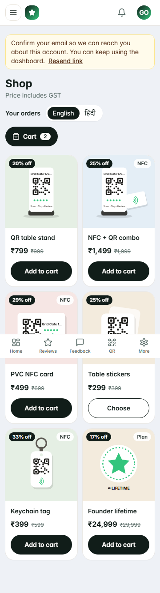

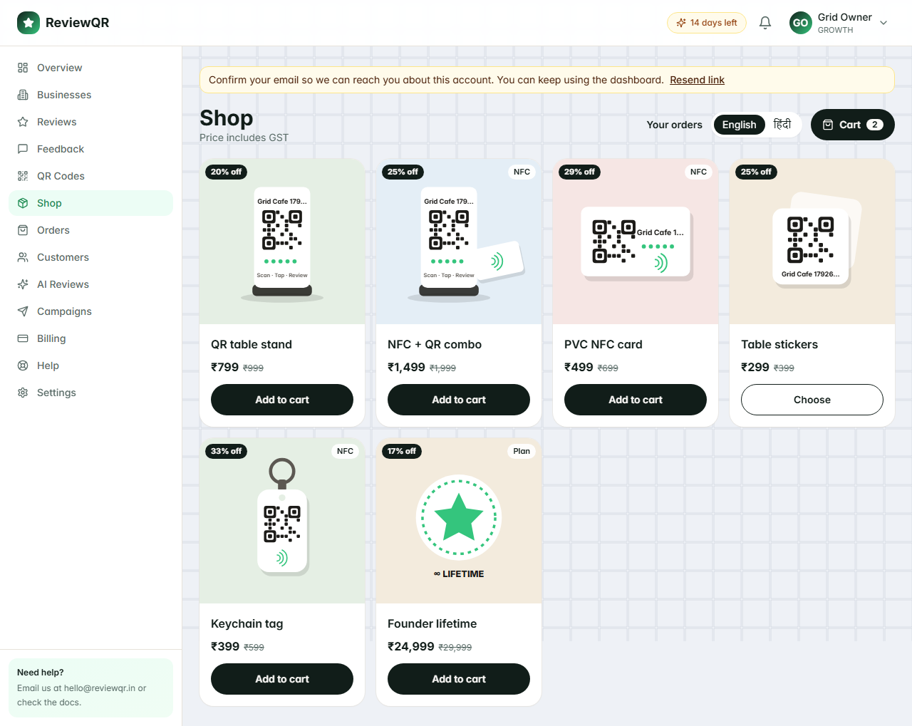

## 6. Storefront designs

The owner picks a design in store settings, separate from the food, shop, or services layout and from the 20 colour themes. The colour theme still paints the accent. The default is Classic. All four designs share the same menu, cart, coupons, charges, and WhatsApp order. Food keeps the veg mark and a Rows control inside the design. Services show the duration and Book.

Screenshots of the demo café, at 360px and 1280px, live in `docs/storefront-designs/`.

### Classic

The current compact food list, and the current shop grid. At 360px the shop is two columns. From 1200px it is four. Services stay a row with duration, Book, and Enquire. This is the default, and existing stores stay here until the owner chooses another design.

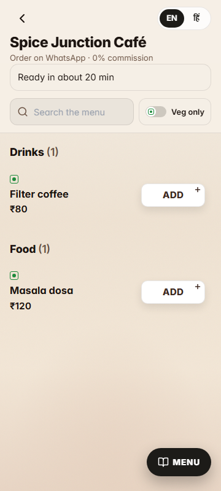

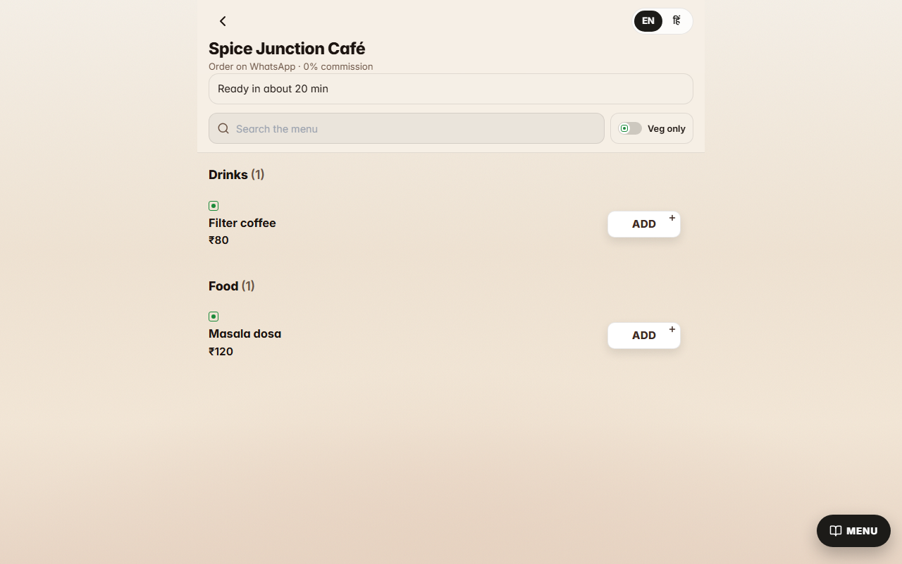

### Premium Store

A warm off-white page. Headings use Bricolage Grotesque and body text uses Geist, loaded only on this design. The header sticks, with the logo, a large rounded search field, and a cart button. Categories are circles: a photo from the first item in that category, or initials when there is no photo. The first offer banner is the hero. The next two are promo cards on a tint of the theme accent. Deal of the day and the flash-sale row share a live countdown to the soonest coupon or banner expiry, and both hide when nothing expires. The flash row is discounted products only. Product cards use a large rounded image, a percent-off badge, the title, the price with a crossed MRP, and Add. Recently added sits under the catalogue. Food can switch to the compact rows. Services are a single column with the duration and Book. A Light / Dark control is saved in `rq-store-scheme` and follows the phone until the customer chooses. On phones, a floating pill has Home, Categories, a larger Cart with the count, Orders (the last `/o/` link saved for this store), and Search.

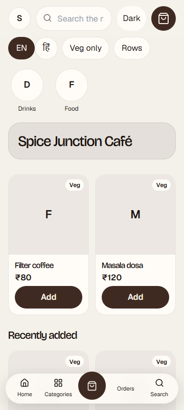

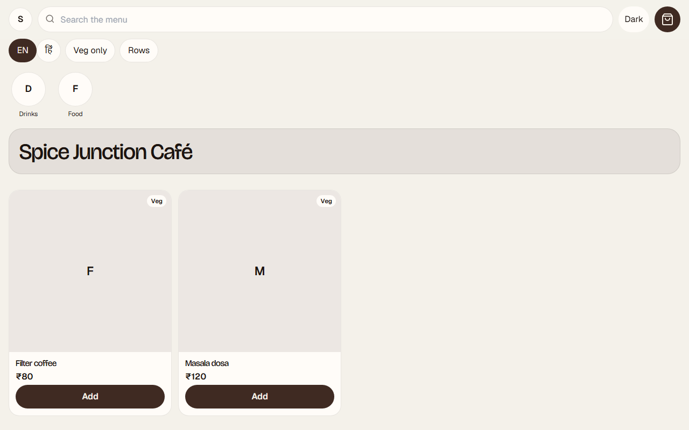

### Minimal

A white page with large type and one column of big photos, aimed at boutiques. It has the same catalogue, search, categories, banners, deal, and recently added block. It has no bottom pill and no dark mode.

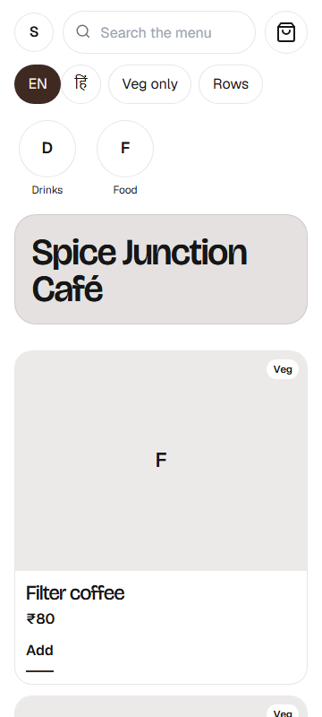

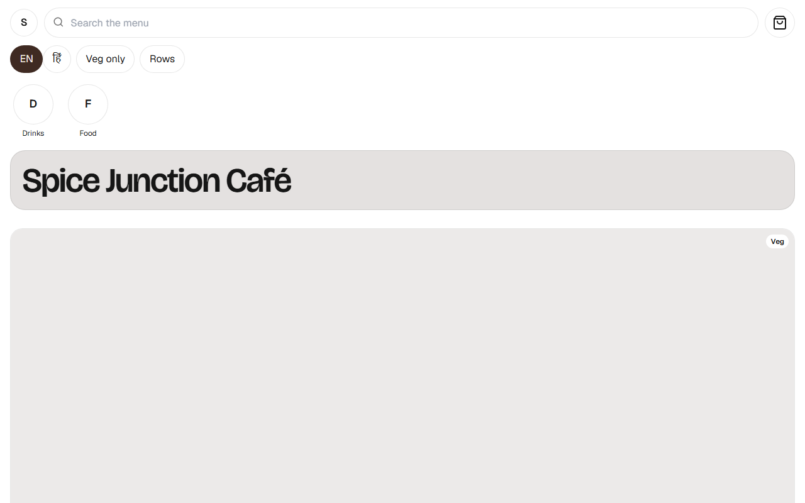

### Bold Dark

Dark glass cards and a neon accent taken from the colour theme. Light mode keeps the same layout on a light glass surface. It includes the phone pill and the Light / Dark control.

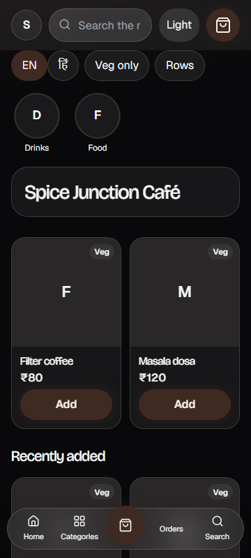

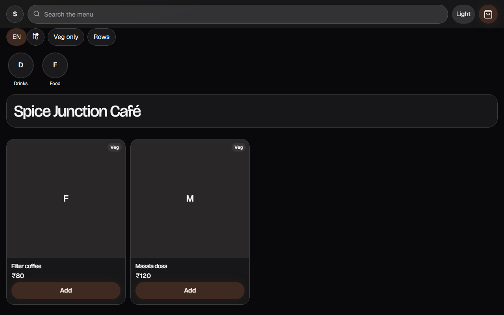

The owner picker shows each design as live markup laid out at 360px and scaled into the thumbnail. The pressed thumbnail is the design that will be saved.

## 7. Print studio and NFC tags

Print studio makes the physical piece at its real size. The library is a CR80 card (85.6×54 mm, front and back), A6 and A5 table tents, 4×6 in and 5×7 in standees, 50 mm and 75 mm round stickers, 60 mm and 100 mm square stickers, A4 and A3 counter posters, an 80×140 mm bill strip, a 30×50 mm keychain, and a 120×180 mm door sticker.

The editor shows the piece while it is edited: logo, business name, an English line and a Hindi line, an NFC mark, five stars, the 20 tap colour presets, a Devanagari font, and a background image. The QR is square, rounded, or dots, with a choice of eyes and a centre logo. It always uses error correction H, a four-module quiet zone, and dark modules on a light ground. A code that would print under 20 mm is allowed and warned. Inverted ink is refused. Hindi and any other complex script is drawn in the browser and placed in the PDF as an image. Latin text and the QR stay vector.

A PDF can be one piece at exact size (front, then back, for a card printer), the same piece with 3 mm bleed and crop marks, or a sheet: 10 CR80 cards on A4, 4 A6 tents on A4, SRA3, or 12×18 in, with cut marks. PNG is 300 DPI. SVG is the vector drawing. Blank stock and Table 1..N each get their own code in one PDF or one ZIP. The browser print view uses `@page` at the piece size and tells the operator to print at 100% / actual size.

Each printed code can have a device: card, standee, sticker, or keychain, with an NTAG213, 215, or 216 UID, a batch, and a status of in stock, assigned, active, disabled, or lost. Chrome on Android writes `https://<domain>/t/<code>?src=nfc`, reads it back, and stores the UID. The next tap can write the next code. iPhone and desktop show the NFC Tools fallback. The page cannot lock a tag. After the link checks out, NFC Tools → Other → Lock tag does that.

An owner or agent opens Activate a tag, scans the QR or follows the tag, picks a business or creates one, and the code goes live. An admin can mark a live tag lost, or put a lost or disabled tag back on a business, without printing a new code. Those changes are in the audit log. `/q/<code>` and `/t/<code>` stay the customer pages.

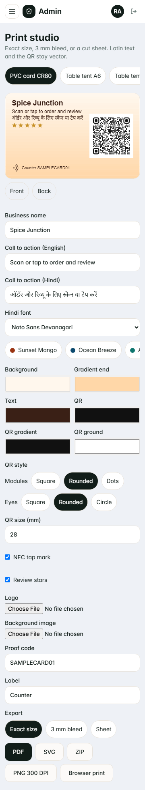

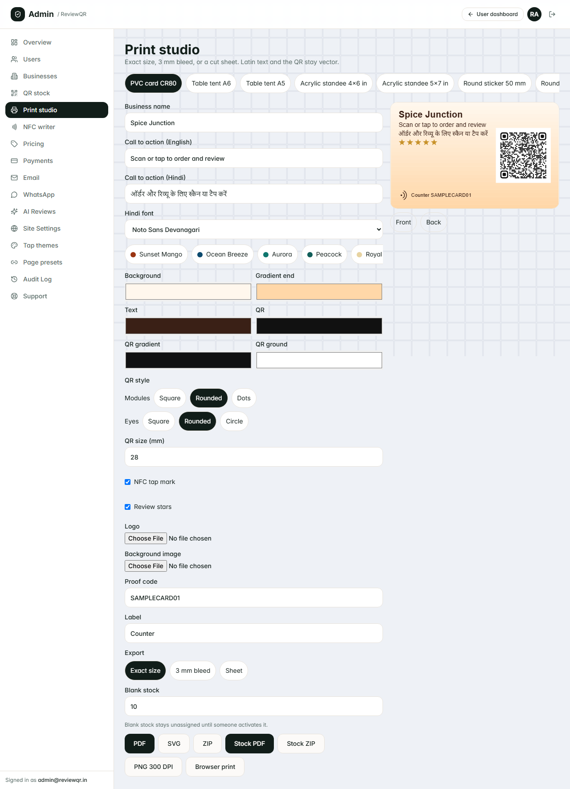

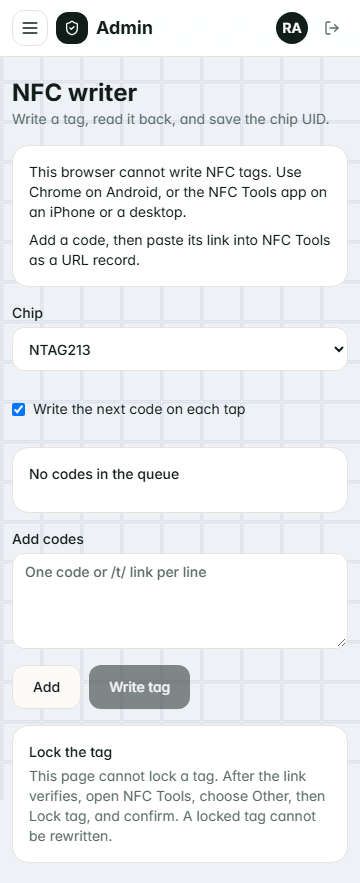

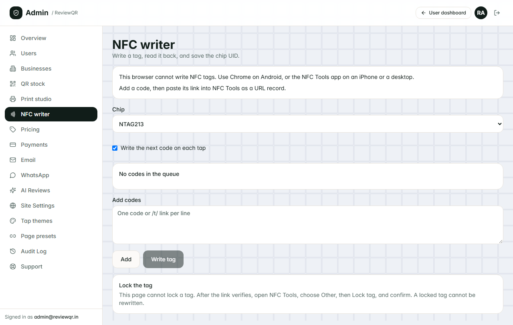

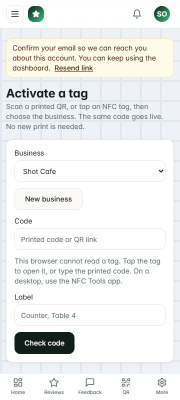

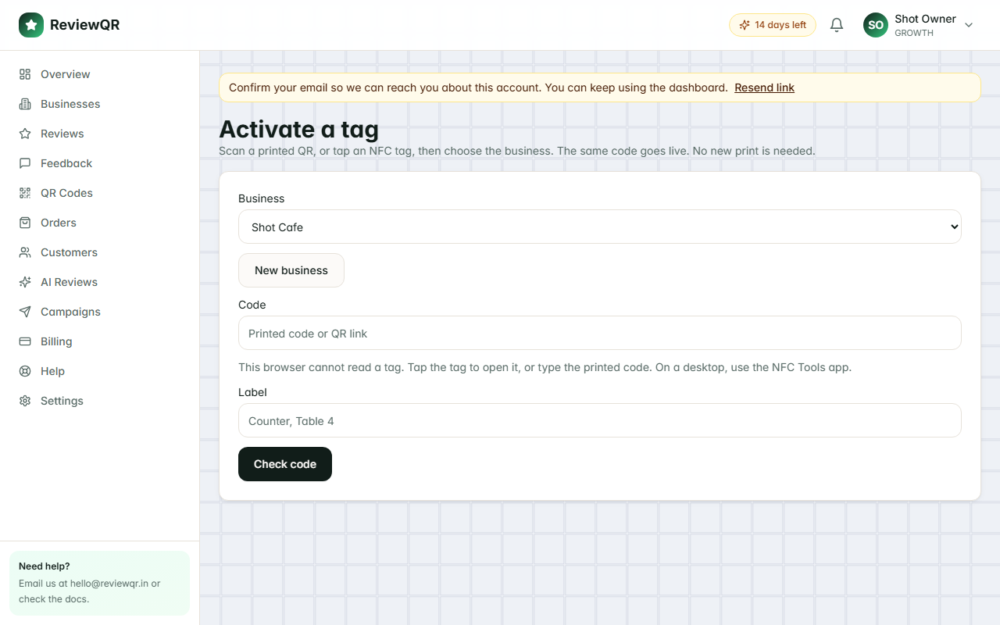

## Done means

- Every page in scope matches the direction above at 360, 390, 768 and 1280px with no horizontal scroll.
- Lighthouse mobile ≥ 90 (performance and accessibility) on the landing page, the customer tap page and the store page.
- Screenshots at those widths are attached to the PR for review.
